<p align="center">
  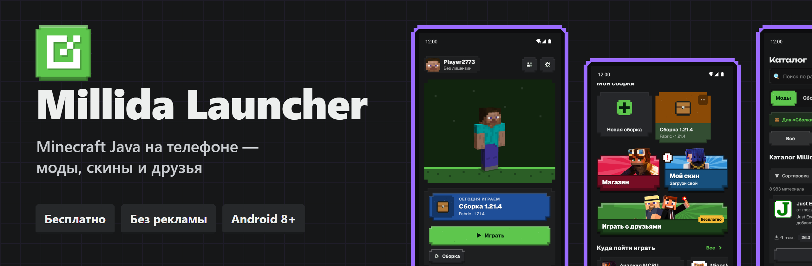
</p>

<p align="center">
  <a href="https://millida.net/launcher/dl/android">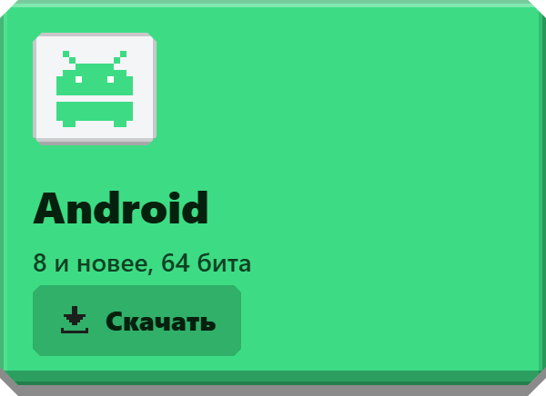</a>
</p>

<p align="center">
  <a href="https://millida.net/launcher"></a>
  
  <a href="LICENSE"></a>
</p>

<p align="center">
  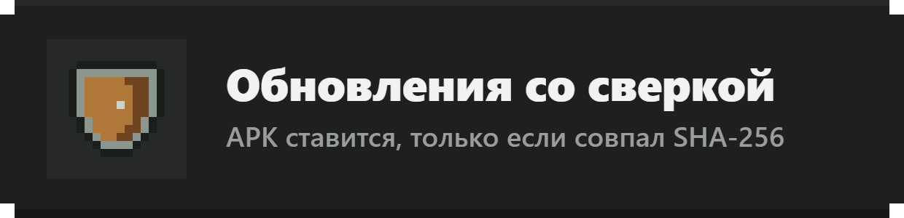
  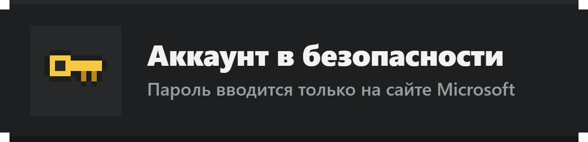
  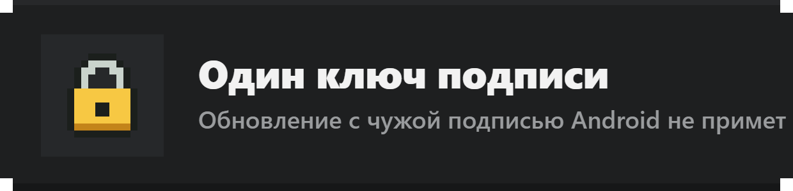
  <a href="https://github.com/millida/launcher-mobile/commits/main">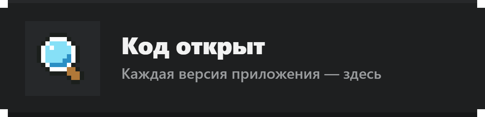</a>
</p>

| Лобби | Сборки и серверы | Каталог |
| :---: | :---: | :---: |
| 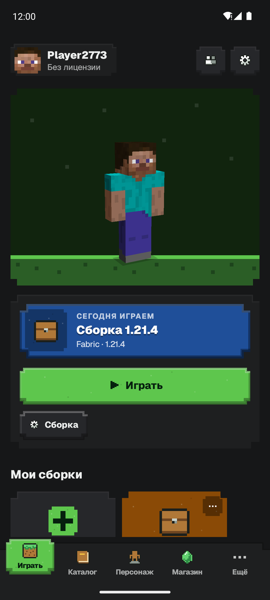 | 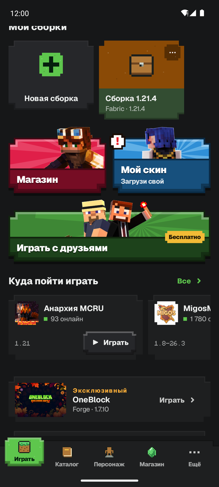 | 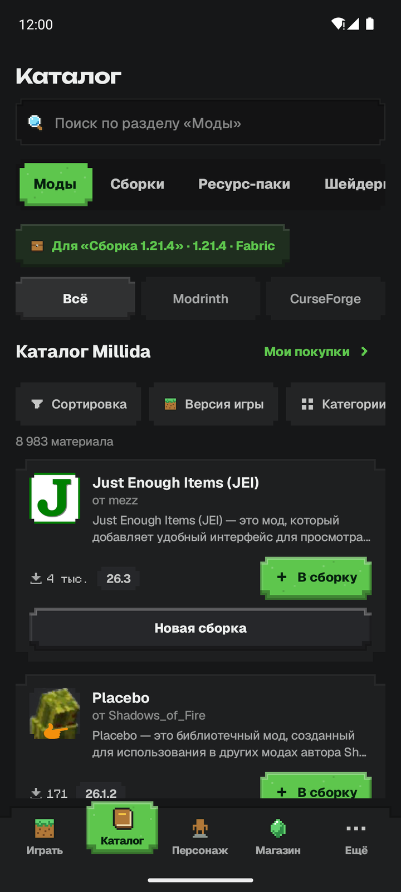 |
| **Новая сборка** | **Персонаж** | **Ещё** |
| 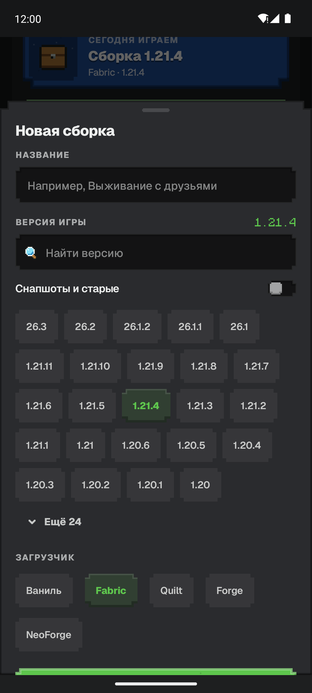 | 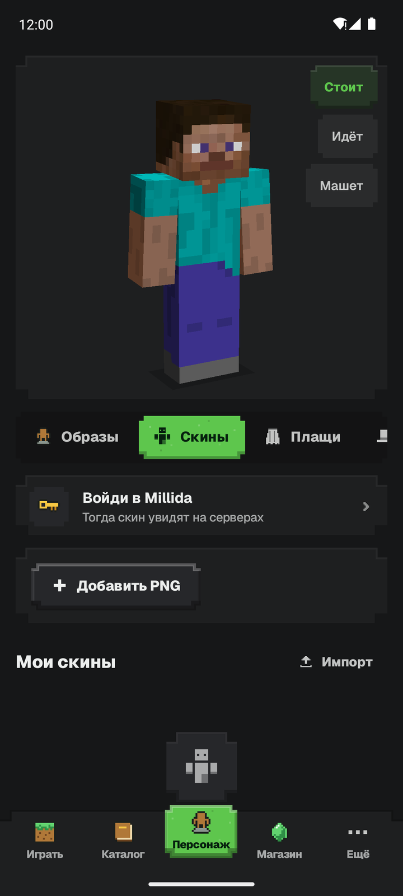 | 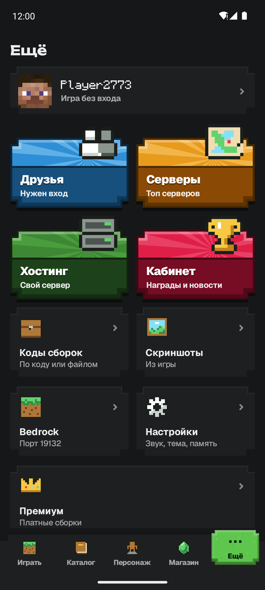 |

<p align="center">
  <a href="BUILDING.md">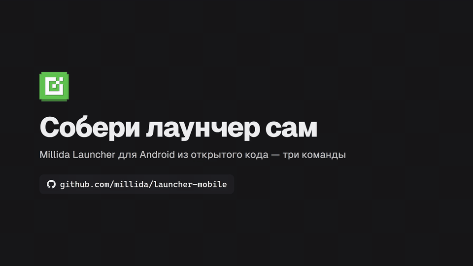</a>
</p>

## Установка

<details>
<summary><b>Android</b> — файл <code>.apk</code></summary>

1. Нажми «Скачать» выше или открой [millida.net/launcher](https://millida.net/launcher) с телефона.
2. Открой скачанный файл. Телефон спросит про установку из браузера — разреши («Установка неизвестных приложений»).
3. Создай сборку или выбери готовую в каталоге и нажми «Играть». Файлы игры скачаются при первом запуске — один раз.

Обновления лаунчер ставит сам.
</details>

<details>
<summary><b>Какой телефон нужен</b></summary>

Android 8.0 и новее, 64-битный процессор (arm64), от 4 ГБ памяти, OpenGL ES 3.0; для шейдеров — ES 3.2.

«Приложение несовместимо с вашим телефоном» при установке — значит, телефон 32-битный: на нём Java-версия Minecraft не запустится.
</details>

## Вопросы

<details>
<summary><b>Это бесплатно?</b></summary>

Да. Без рекламы.
</details>

<details>
<summary><b>Нужен купленный Minecraft?</b></summary>

Нет: без лицензии можно играть по нику на серверах Millida. С лицензией — вход через официальную страницу Microsoft по коду, пароль лаунчер не видит.
</details>

<details>
<summary><b>Это Pocket Edition?</b></summary>

Нет, это Minecraft Java Edition — те же версии, что на компьютере, с модами Fabric, Quilt, Forge и NeoForge, ресурспаками и шейдерами из Modrinth и CurseForge.
</details>

<details>
<summary><b>Почему нет в Google Play и App Store?</b></summary>

Правила обоих магазинов запрещают приложениям скачивать исполняемый код — а лаунчеру нужны Java-машина, игра и моды. Поэтому APK раздаётся с сайта. Версии для iPhone нет: iOS не даёт запускать Java-машину с нормальной скоростью.
</details>

<details>
<summary><b>Чёрный экран или игра тормозит</b></summary>

Лаунчер сам подбирает рендерер под видеочип. Если картинка не появилась — выбери другой в «Ещё» → «Настройки» → «Рендерер». Для слабых телефонов — ваниль или Fabric и дальность прорисовки 6.
</details>

<details>
<summary><b>Что-то не работает</b></summary>

Напиши в [Discord](https://discord.gg/mcru) или заведи issue. Приложи отчёт: после вылета — кнопка «Отправить отчёт», в остальных случаях — вкладка «Логи» в сборке.
</details>

## Разработчикам

Kotlin и Jetpack Compose, лицензия [GPL-3.0-only](LICENSE). Своя реализация, не форк: лаунчер, интерфейс и слой запуска написаны здесь. Из чужих проектов берутся только готовые двоичные части рантайма — Java-машина под arm64 и рендереры; они скачиваются со сверкой SHA-256 и в исходники не входят. Откуда и под какой лицензией — [scripts/runtime_sources.json](scripts/runtime_sources.json).

[Как собрать самому](BUILDING.md)

<details>
<summary><b>Как устроен</b></summary>

```
core/        чистая логика: сеть, установка, профили, аккаунты, аргументы запуска
bridge/      jar, который подменяет org.lwjgl.glfw внутри игры
processors/  драйвер шагов установщика Forge и NeoForge (Java 8+)
runtime/     Android-библиотека: нативный хост Java-машины, EGL, ввод, служба
app/         интерфейс на Compose
scripts/     генератор обратных вызовов, сборка манифеста рантайма
```

`core` не знает про Android и проверяется на настольной Java, `runtime` не знает про интерфейс, `app` не работает с файлами игры напрямую.
</details>

<details>
<summary><b>Зачем открыт код</b></summary>

Лаунчер держит вход в аккаунт Microsoft, файлы игры и сетевые запросы — честный ответ на вопрос «что он делает с моим аккаунтом» — дать прочитать код целиком.

- Официальный APK — только с [millida.net/launcher](https://millida.net/launcher).
- Сторонние сборки мы не поддерживаем. Собрать код для себя это не мешает.
- GPL-3.0 даёт право на форк, но бренд, ключи и наши сервисы под неё не подпадают — см. [TRADEMARK.md](https://github.com/millida/launcher/blob/main/TRADEMARK.md).
</details>

<sub>Millida Launcher не связан с Mojang AB и Microsoft. Minecraft — товарный знак Mojang AB. Android — товарный знак Google LLC.</sub>
