<p align="center">
  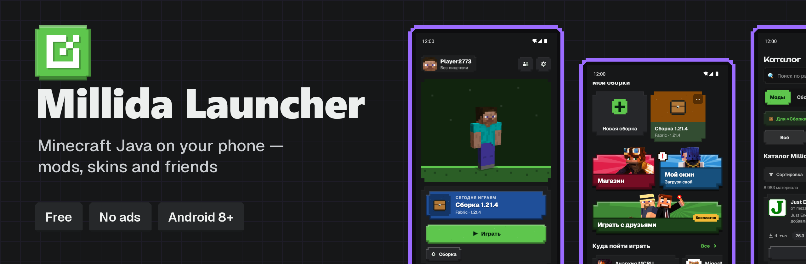
</p>

<p align="center">
  <a href="https://millida.net/launcher/dl/android">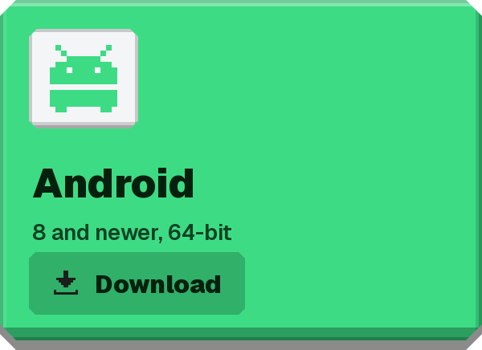</a>
</p>

<p align="center">
  <a href="https://millida.net/launcher"></a>
  
  <a href="LICENSE"></a>
</p>

<p align="center">
  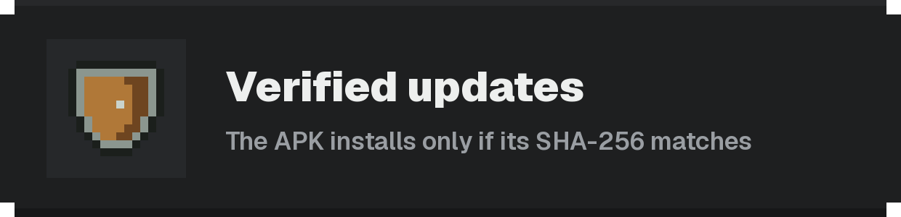
  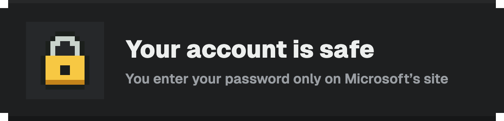
  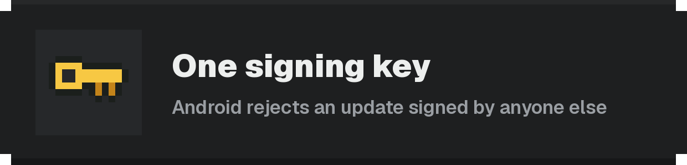
  <a href="https://github.com/millida/launcher-mobile/commits/main">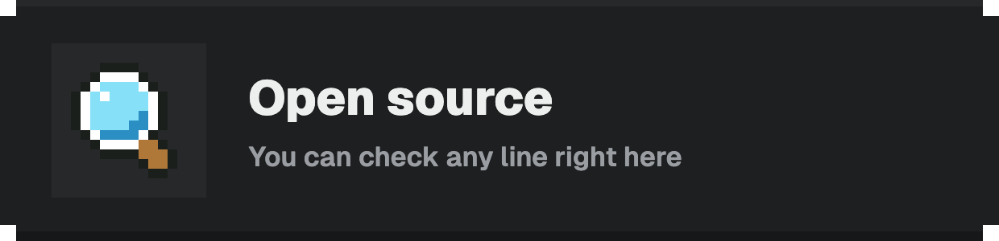</a>
</p>

| Lobby | Instances and servers | Catalog |
| :---: | :---: | :---: |
| 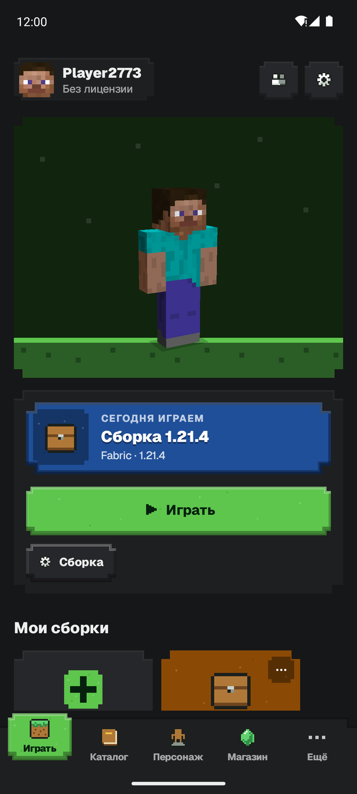 | 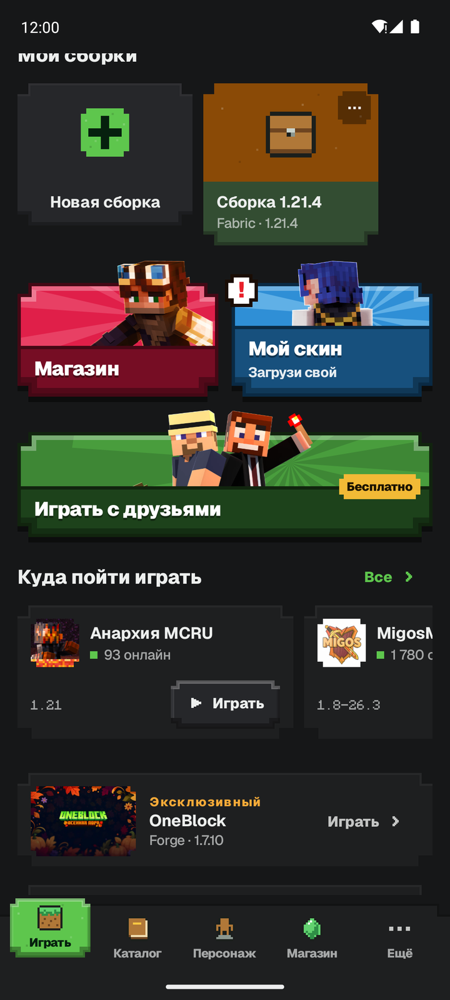 | 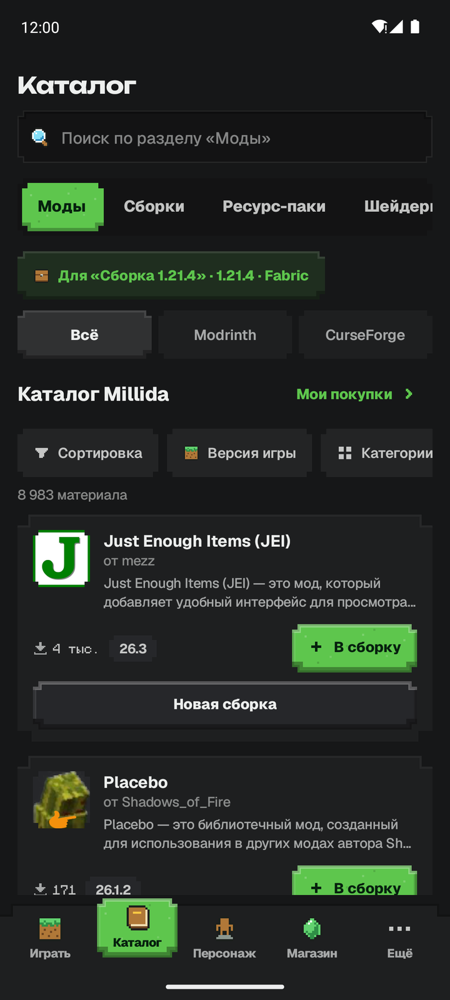 |
| **New instance** | **Character** | **More** |
| 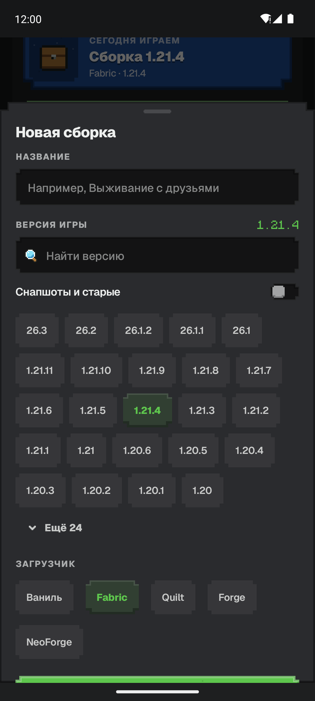 | 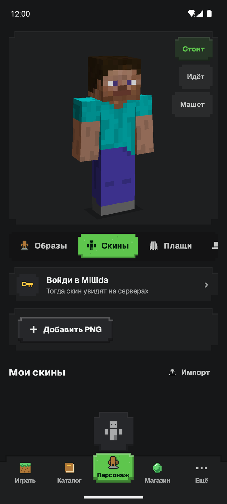 | 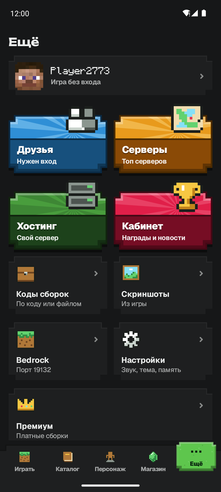 |

*English | Russian version: [README.ru.md](README.ru.md)*

## Install

<details>
<summary><b>Android</b>: <code>.apk</code> file</summary>

1. Tap "Download" above, or open [millida.net/launcher](https://millida.net/launcher) on your phone.
2. Open the downloaded file. The phone will ask about installing from the browser: allow it ("Install unknown apps").
3. Create an instance or pick a ready one in the catalog and tap "Play". The game files are downloaded on the first launch, only once.

The launcher installs its updates itself.
</details>

<details>
<summary><b>Which phone you need</b></summary>

Android 8.0 or newer, a 64-bit processor (arm64), 4 GB of memory or more, OpenGL ES 3.0; ES 3.2 for shaders.

If the installer says "App not compatible with your phone", the phone is 32-bit: the Java edition of Minecraft will not run on it.
</details>

## FAQ

<details>
<summary><b>Is it free?</b></summary>

Yes. There are no ads.
</details>

<details>
<summary><b>Do I need a paid copy of Minecraft?</b></summary>

No. Without a license you can play with a nickname on Millida servers. With a license, you sign in on the official Microsoft page using a code. The launcher never sees your password.
</details>

<details>
<summary><b>Is this Pocket Edition?</b></summary>

No, this is Minecraft Java Edition: the same versions as on a computer, with Fabric, Quilt, Forge and NeoForge mods, resource packs and shaders from Modrinth and CurseForge.
</details>

<details>
<summary><b>Why is it not on Google Play or the App Store?</b></summary>

The rules of both stores forbid apps to download executable code, and the launcher needs a Java machine, the game and mods. That is why the APK comes from the website. There is no iPhone version: iOS does not let a Java machine run at a usable speed.
</details>

<details>
<summary><b>Black screen or the game lags</b></summary>

The launcher picks the renderer for your graphics chip itself. If no picture appears, choose another one in "More" → "Settings" → "Renderer". For weak phones: vanilla or Fabric and a render distance of 6.
</details>

<details>
<summary><b>Something does not work</b></summary>

Write in [Discord](https://discord.gg/mcru) or open an issue. Attach a report: after a crash, use the "Send report" button; in other cases, the "Logs" tab of the instance.
</details>

## For developers

Kotlin and Jetpack Compose. License: [GPL-3.0-only](LICENSE). Our own implementation, not a fork: the launcher, the interface and the launch layer are written here. Only ready-made binary parts of the runtime come from other projects: the Java machine for arm64 and the renderers. They are downloaded with a SHA-256 check and are not part of the source. Where they come from and under which license: [scripts/runtime_sources.json](scripts/runtime_sources.json) and [THIRD-PARTY.md](THIRD-PARTY.md).

[How to build it yourself](BUILDING.md) · [How to send a fix](CONTRIBUTING.md) · [Where the APK comes from](SAFETY.md) · [Vulnerabilities](SECURITY.md) · [Name and logo](TRADEMARK.md)

<details>
<summary><b>How it is built</b></summary>

```
core/        pure logic: network, installation, profiles, accounts, launch arguments
bridge/      a jar that replaces org.lwjgl.glfw inside the game
processors/  the step driver of the Forge and NeoForge installers (Java 8+)
runtime/     Android library: native host of the Java machine, EGL, input, service
app/         the Compose interface
scripts/     callback generator, runtime manifest builder
```

`core` knows nothing about Android and is tested on desktop Java, `runtime` knows nothing about the interface, `app` never touches the game files directly.
</details>

<details>
<summary><b>Why the code is open</b></summary>

The launcher handles your Microsoft sign-in, the game files and network requests. The honest answer to "what does it do with my account" is to let you read all of the code.

- The official APK comes only from [millida.net/launcher](https://millida.net/launcher).
- We do not support third-party builds. You can still build the code for yourself.
- GPL-3.0 gives you the right to fork. The brand, the keys and our services are not covered by it. See [TRADEMARK.md](TRADEMARK.md).
</details>

<sub>Millida Launcher is not affiliated with Mojang AB or Microsoft. Minecraft is a trademark of Mojang AB. Android is a trademark of Google LLC.</sub>
